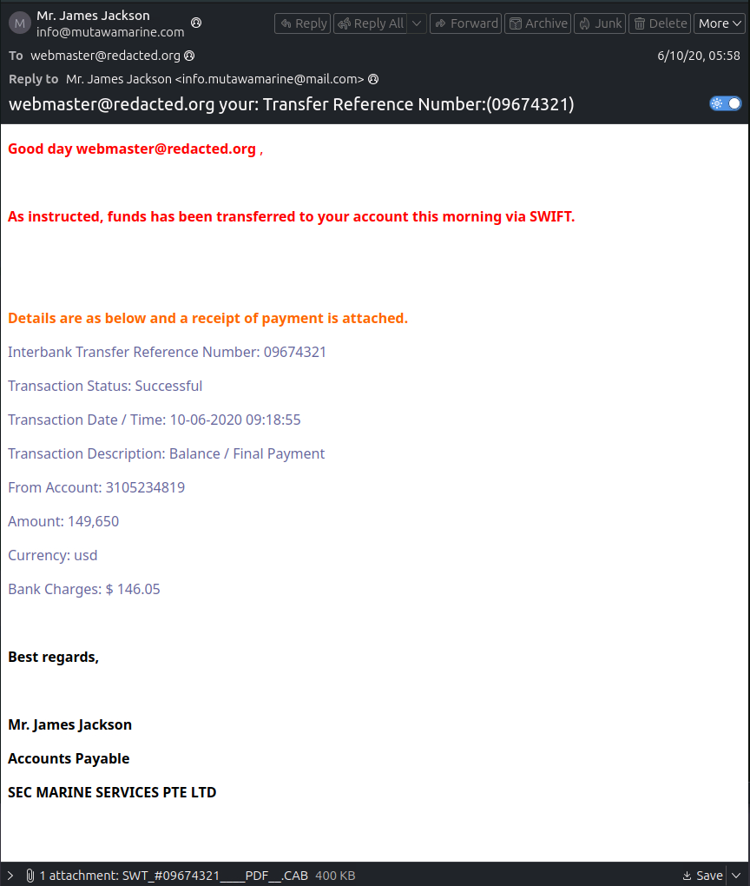
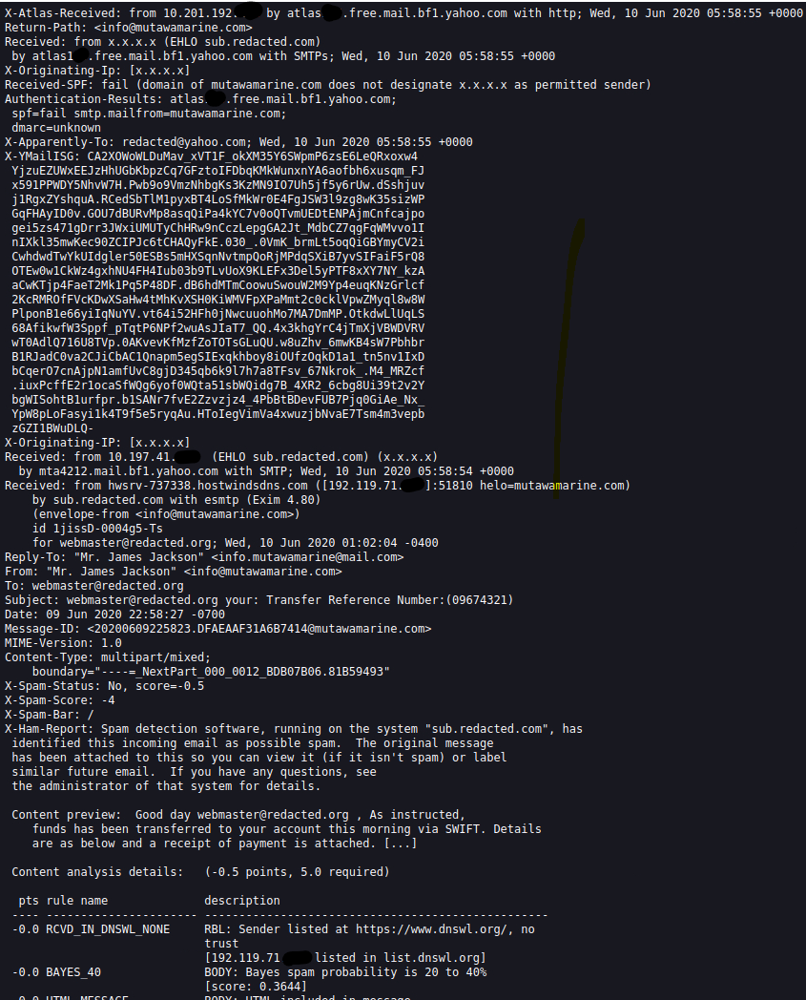
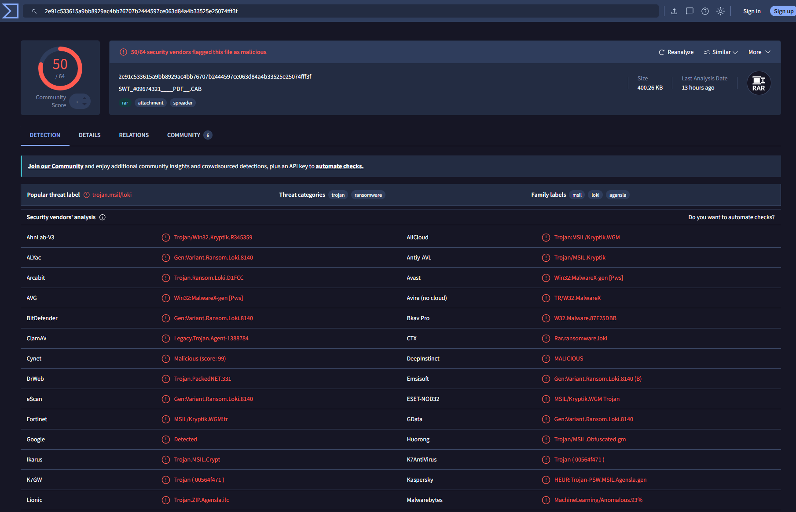

# Investigation #2 — "Phishing Email Analysis"

> #### This is a guided exercise from TryHackMe's "The Greenholt Phish" training lab, and not an actual phishing email analysis. Differences between detection/alert dates and analysis dates are due to the relative age of this online exercise.

---------------------------------------------------------------------------------------------------------------------------------------------------

> **Case status:** Lab investigation
> 
> **Environment:** TryHackMe's "The Greenholt Phish" training lab
> 
> **Analyst:** cmcclister
> 
> **Analysis date:** 2026-11-04
> 
> **Case / alert ID:** N/A
> 
> **Sample source:** hxxps://tryhackme[.]com/room/phishingemails5fgjlzxc
> 
> **Handling note:** Do not open links or attachments on a production workstation. Any sample data in this report has been sanitized for publication.

## Executive Summary

An email titled **webmaster@redacted[.]org your: Transfer Reference Number:(09674321)**, received by **webmaster@redacted[.]org** on **2020/06/10, 10:58 AM UTC**, was investigated after **the employee alerted us that this behavior does not align with the customer's usual communication style**. The analysis reviewed the message headers, sender authentication, domains, and attachment(s), with reputation checks performed using VirusTotal.

**Assessment:** Malicious  
**Confidence:** High  
**User interaction:** Reported by employee who received the email, attachment not opened  
**Analyst interaction:** Attachment hash analyzed  
**Impact observed:** None identified, attachment was not opened by analyst

The conclusion is based on a **VirusTotal scan of the email attachment hash, confirmed as a Trojan/Infostealer RAR archive file**.

## Alert Details

| Field | Value |
|---|---|
| Alert name / ID | N/A |
| Proposed Triage Rating | High (attachment is malicious, but was not opened by the investigator) |
| Detection source | Training alert |
| Alert time | 2020-06-10 10:58 AM UTC |
| Recipient | webmaster@redacted[.]org |
| Trigger / reason | According to the employee, this behavior does not align with the customer's usual communication style. Concerned that the email may be malicious, the message has been escalated to the SOC (Security Operations Center) for further investigation. |
| Investigation scope | Email, file attachment (hash lookup), and online domain investigation |

## Email Metadata

| Field | Value |
|---|---|
| Subject | webmaster@redacted[.]org your: Transfer Reference Number:(09674321) |
| From (display name) | "Mr. James Jackson" **NOTE**: Possible instance of display-name/domain mismatch. |
| From (address) | info@mutawamarine[.]com |
| Reply-To | info[.]mutawamarine@mail[.]com |
| Return-Path | info@mutawamarine[.]com |
| To / Cc | webmaster@redacted[.]org |
| Date | 10 Jun 2020 10:58 AM UTC |
| Message-ID | 20200609225823.DFAEAAF31A6B7414@mutawamarine[.]com |
| Received chain | "Received: from 10[.]197[.]41[.][REDACTED]  (EHLO sub.redacted[.]com) (x.x.x.x) by mta4212[.]mail[.]bf1[.]yahoo[.]com with SMTP; Wed, 10 Jun 2020 05:58:54 +0000. Received: from hwsrv-737338[.]hostwindsdns[.]com ([192[.]119[.]71[.][REDACTED]]:51810 helo=mutawamarine[.]com) by sub[.]redacted[.]com with esmtp (Exim 4.80) (envelope-from <info@mutawamarine[.]com>) id 1jissD-0004g5-Ts for webmaster@redacted[.]org; Wed, 10 Jun 2020 01:02:04 -0400" |
| Source IP | 192[.]119[.]71[.][REDACTED] |
| MIME type / encoding | multipart/mixed |
| Authentication-Results | atlas[REDACTED][.]free[.]mail[.]bf1[.]yahoo[.]com |
| Received-SPF | fail (domain of mutawamarine[.]com does not designate x.x.x.x as permitted sender) |

**NOTE**: In the "Received chain" header excerpt, the first hop has a private IP address. 10.x.x.x addresses are internal, so the 10.197.41.x address is probably an internal address behind NAT or a relay on the redacted domain's network, not a public IP.

## Sender Analysis

The visible sender was **info@mutawamarine[.]com** and the Reply-To address was **info[.]mutawamarine@mail[.]com**.

The sending infrastructure showed **IP address of 192[.]119[.]71[.][REDACTED]**.

## Authentication Results

| Control | Result | Evidence / notes |
|---|---|---|
| SPF | Fail at the receiving server | "Received-SPF: fail (domain of mutawamarine[.]com does not designate x.x.x.x as permitted sender)" from email message source. No SPF record found per hxxps://dmarcian[.]com/spf-survey/. |
| DKIM | Unknown | No DKIM record found, per hxxps://mxtoolbox[.]com/dkim[.]aspx |
| DMARC | Unknown | "dmarc=unknown" from email message source |

**Interpretation:** Authentication on SPF failed; DKIM and DMARC are both unknown, per email message source, hxxps://dmarcian[.]com/spf-survey/, hxxps://mxtoolbox[.]com/dkim[.]aspx, and hxxps://mxtoolbox[.]com/dkim[.]aspx. However, the "From" address is an immediate red flag as the sender details **info@mutawamarine[.]com** do not match the actual "Reply-To" address **info[.]mutawamarine@mail[.]com**. In addition, in the email message source, **Received-SPF** has a value of **fail (domain of mutawamarine does not designate x.x.x.x as permitted sender)**.

## URL Analysis

| URL / defanged URL | Location in email | Redirects / final destination | VirusTotal result | Assessment |
|---|---|---|---|---|
| N/A | No URLs in the email body | N/A | N/A | N/A |

## Domain Analysis

| Domain | Role | Observations | DNS check | Assessment |
|---|---|---|---|---|
| **Received-SPF**: mutawamarine[.]com | Sender | No SPF, DKIM or DMARC records found, per hxxps://mxtoolbox[.]com/dkim[.]aspx, hxxps://dmarcian[.]com/spf-survey/, and hxxps://dmarcian[.]com/domain-checker/. | Per hxxps://urlscan[.]io/, verdict of "No classification" returned. | Inconclusive, the limited information on this domain does not indicate that it is suspicious. **Received-SPF** value of **fail** in the email message source suggests that it may not be a safe domain. |
| **Authentication-Results**: atlas[REDACTED][.]free[.]mail[.]bf1[.]yahoo[.]com | Sender | No SPF, DKIM or DMARC records found, per hxxps://mxtoolbox[.]com/dkim[.]aspx, hxxps://dmarcian[.]com/spf-survey/, and hxxps://dmarcian[.]com/domain-checker/. | Per hxxps://urlscan[.]io/, this domain was first seen three years ago, but was never scanned, so no malicious verdict returned. | Inconclusive, the limited information on this domain does not indicate that it is suspicious. |

## Attachment Analysis

| File name | Type / size | SHA-256 | VirusTotal result | Assessment |
|---|---|---:|---|---|
| "SWT_#09674321____PDF__.CAB" | RAR Archive / 400.26 KB | 2e91c533615a9bb8929ac4bb76707b2444597ce063d84a4b33525e25074fff3f | 2026-11-04, 50/64 security vendors flagged this file as malicious | Attachment identified as Lokibot Trojan/Infostealer; misleadingly named with ".CAB" extension when the actual file is ".RAR" |

**Analysis performed:** hash lookup at hxxps://www[.]virustotal[.]com/gui/home/search

**Findings:** Per VirusTotal search of the hash, analyzed on 2026-11-04, "50/64 security vendors flagged this file as malicious". The "Popular threat label" is noted as **trojan.msil/loki**, the "Threat categories" as **trojan**, and the "Family labels" as **msil**, **loki**, and **agensla**. "Loki" was noted by a majority of engines in the "Security vendors' analysis", including "ALYac", "Arcabit", "BitDefender", "CTX", "Emisoft", "GData", and others.

**Safety note:** File was hashed in an isolated environment. The file was **sha256sum** hashed in Terminal with the resulting hash value checked at hxxps://www[.]virustotal[.]com/gui/home/search

## Indicators of Compromise

| Type | Indicator | Context | Confidence |
|---|---|---|---|
| Sender address | info@mutawamarine[.]com | Unknown | Medium |
| Sender IP | 192[.]119[.]71[.][REDACTED] | Email | Medium |
| URL | N/A | No URLs in the email body | N/A |
| Domain | mutawamarine[.]com | Fail at the receiving server | Medium |
| File hash | "SWT_#09674321____PDF__.CAB"-named RAR Trojan/Infostealer | 2e91c533615a9bb8929ac4bb76707b2444597ce063d84a4b33525e25074fff3f | High |

## MITRE ATT&CK Mapping

| Technique | Name | Evidence / rationale |
|---|---|---|
| T1566.001 | Initial Access: Phishing: Spear Phishing Attachment | A malicious RAR attachment contained within a Spear Phishing email. |

## Determination

**Verdict:** Malicious attachment

**Confidence:** High

**Rationale:** Email asssessed as malicious with high confidence based on the attachment hash reputation. VirusTotal hash scan of the email attachment determined that it was a RAR archive file associated with Lokibot Trojan/Infostealer.

**Evidence gaps:**  No dynamic analysis, verdict of "No classification", per hxxps://urlscan[.]io/, no confirmation whether or not the file was opened. Recipient execution and endpoint impact were not assessed.

**Scope limitation:** Email message source was examined, as well as the hashed value of the attachment, in a controlled lab environment.

## Recommended Actions

1. **Contain:** Quarantine or remove the message from affected mailboxes.
2. **Protect users:** Block confirmed malicious file hash, sender domain, and IP using appropriately scoped controls. Search for other recipients of similar messages, reset credentials if the user interacted with the file, and add a detection rule for the subject pattern.
3. **Investigate exposure:** Search mail, proxy, DNS, EDR, and authentication logs for the indicators and recipient activity. Determine whether the URL was visited or the attachment was opened.
4. **Respond to interaction:** Isolate the affected endpoint and investigate it under the incident-response process, but only if the attachment was opened.
5. **Monitor:** Look for related messages, redirects, follow-on activity, and attempts to contact the identified infrastructure.
6. **Document:** Preserve the original message and relevant logs according to evidence-handling procedures; record tool names, query dates, and results.

## Lessons Learned

- The message attachment, hashed, and verified with VirusTotal was most useful in identifying the issue.
- While the email itself looked suspicious (generic greeting, odd formatting, inconsistent From and Reply-To addresses), an investigation into the sender's domain was inconclusive. The authentication results were mixed, and misaligned between the From, Reply-To, and Return-Path warrants further investigation. It was only after investigating the attachment that the email was confirmed as malicious.
- VirusTotal established that the email attachment is an RAR archive file associated with Lokibot Trojan/Infostealer.
- I believe that monitoring endpoint activity and scanning email attachments would help find an issue like this in the future.
- I would also recommend the use of multi-factor authentication and employee IT security training, especially around social engineering, to help prevent future phishing attempts.

## Evidence and Tool Notes

| Item | Tool / source | Check date and time (UTC) | Result / limitation |
|---|---|---|---|
| Email headers | Message source | 2026-11-04 | See **Email Metadata** above |
| URL / domain reputation | N/A | 2026-11-04 | The email did not contain any links |
| File hash / reputation | VirusTotal | 2026-11-04 | 50/64 security vendors flagged this file as malicious |
| Other analysis | hxxps://dmarcian[.]com/spf-survey/, hxxps://www[.]virustotal[.]com/gui/home/search, hxxps://dmarcian[.]com/domain-checker/, hxxps://urlscan[.]io/, and hxxps://mxtoolbox[.]com/dkim[.]aspx | 2026-11-04 | See **Authentication Results** and **Attachment Analysis** above |
| Message-ID | 20200609225823[.]DFAEAAF31A6B7414@mutawamarine[.]com | 2026-11-04| Spam detection software, running on the system "sub.redacted[.]com", has identified this incoming email as possible spam. |

## Screenshots

**Email Body**:

**Email Message Source**:

**VirusTotal Scan Results**:

